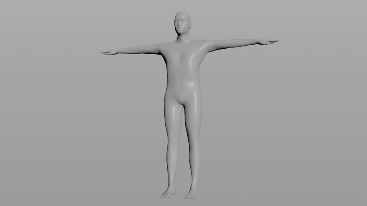
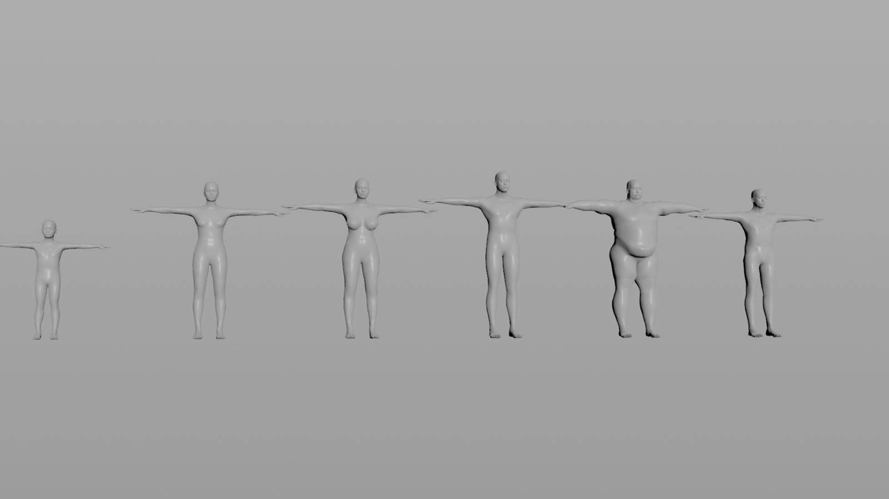
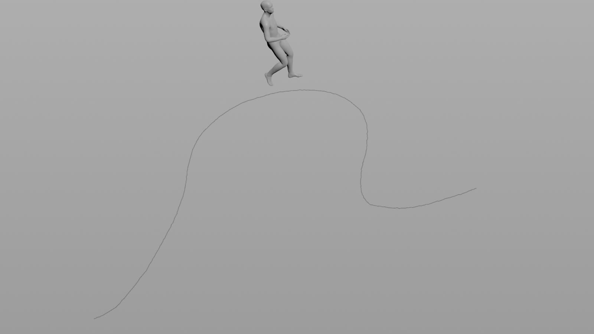

# Human Generator for Houdini

One Houdini node that builds a human body in **real units** (age in years, height in cm, weight in kg) and animates it from **a sentence**, on your own GPU. Wire in a curve and the motion is generated **on that path**.



▶ 79-second overview: https://youtu.be/4f_W35TixIM

| Real units, solved exactly | Motion generated on a drawn curve |
|---|---|
|  |  |

## What it does

- **Body in real units.** Type an age, a height and a weight: the [Anny](https://github.com/naver/anny) body is solved to hit them exactly (6-year-old child to 80-year-old adult, 21 to 169 kg in the examples above). Measured values come out as detail attributes (`height_cm`, `weight_kg`, `age_years`).
- **Shape controls.** Gender, muscle, proportions, breast size and firmness, buttocks, and any of Anny's 139 local changes. The neutral SOMA PCA body is available too.
- **Text to motion.** NVIDIA [Kimodo](https://github.com/nv-tlabs/kimodo) turns a prompt into motion: `a person walks forward. stops and looks around. waves with the right hand.` One sentence per segment, with its own duration and smooth transitions.
- **Motion on a path.** Wire a curve into the node: Kimodo generates the motion on it, then the body is placed back on your curve.
- **Production details.** Eyeballs on the eye joints (groups `eyes`, `left_eye`, `right_eye`, `iris`, `pupil`), UVs, smooth normals, a volume-keeping surface smooth, feet on the ground, a skeleton output (`name`, `transform` per joint), stride scaled to the body so feet do not slide.

All models are open and run locally: no cloud, no subscription.

## Requirements

- Windows 10/11 (Linux should work for the server but is untested)
- Houdini 20.5 (any licence that runs Python SOPs, Apprentice included)
- NVIDIA GPU with 8 GB+ VRAM; tested on an RTX 5070 Ti (16 GB)
- 32 GB RAM recommended (Kimodo's text encoder runs on the CPU by default)
- About 25 GB of disk for the Python environment and the models
- A free Hugging Face account with access to [Meta Llama 3 8B Instruct](https://huggingface.co/meta-llama/Meta-Llama-3-8B-Instruct) (Kimodo's text encoder is gated)

## Install

1. Download or clone this repository, for example to `D:\tools\human-generator`.
2. In PowerShell, from that folder:
   ```powershell
   powershell -ExecutionPolicy Bypass -File .\install.ps1
   ```
   It installs [uv](https://docs.astral.sh/uv/) if needed, creates a Python 3.10 environment in `.venv`, installs PyTorch (CUDA 12.8), Kimodo, SOMA-X and Anny at the tested versions, and writes the Houdini package file `Documents\houdini20.5\packages\human_generator.json`. No compiler or CMake is needed. PyTorch alone is a 2.6 GB download, so the first run can take 10 to 20 minutes on a slow connection.
3. Request access to Llama 3 on Hugging Face, create a **read** token, and log in once:
   ```powershell
   .\.venv\Scripts\hf.exe auth login
   ```
4. Restart Houdini.

The first cook starts the server and downloads the body models (about 1 GB). The first **Generate Motion** downloads Kimodo and Llama 3 (about 17 GB) and takes a few minutes. After that every start is offline: the server loads in 20 to 30 s and a motion takes 5 to 25 s.

## Use

1. In a Geometry network: **Tab > Human Generator**.
2. **Body** tab: set Age, Height (cm), Weight (kg), then gender, muscle and the rest.
3. **Motion** tab: type a prompt, set one duration per sentence (`3 2 2`), press **Generate Motion**, then play the timeline.
4. **Path**: draw a curve on the ground (Draw Curve, Curve), wire it into the node's input and press Generate Motion. *Path Share per Sentence* sets how much of the curve each sentence covers (`0.84 0.16`: run most of it, then roll).
5. **Output**: Body, Skeleton, or both.

Prompts that work well describe one action per sentence in plain words: `a person runs forward. a person does a forward roll like a gymnast.`

## How it works

```
Houdini                                   local server (.venv, GPU)
Human Generator (Python SOP)   ── HTTP ──▶ server/hg_server.py
  sliders, prompt, curve                   ├─ Anny / SOMA-X: body, skeleton, skinning
  ◀── NPZ files (vertices, joints) ───     └─ Kimodo + Llama 3 text encoder: motion
```

Houdini never imports PyTorch: the node sends its settings to a small HTTP server on `127.0.0.1:8777` and reads back NPZ files. The node starts the server by itself (a minimised console window) and caches every result, so scrubbing the timeline never calls the server. The same server can feed other applications; a Blender add-on is planned.

| File | Role |
|---|---|
| `houdini/otls/human_generator.hda` | the node |
| `houdini/python/human_generator/` | the node's code (cook, motion, path, eyes, smoothing) |
| `server/hg_server.py` | body and motion server |
| `server/start_server.bat` | starts the server (Houdini runs it for you) |
| `install.ps1` | environment, models' libraries, Houdini package |
| `tools/build_hda.py` | rewrites the HDA interface from `parms.py` (for development) |

Server settings (environment variables): `HG_PORT` (8777), `HG_DEVICE` (cuda/cpu), `HG_CACHE` (`<repo>/cache`), `KIMODO_MODEL` (`Kimodo-SOMA-RP-v1`), `TEXT_ENCODER_DEVICE` (`cpu`; set `cuda` on a 24 GB card for faster prompts).

## Troubleshooting

- **"HUMAN_GENERATOR is not set"**: the package file is missing. Run `install.ps1` again and restart Houdini.
- **The server does not start**: run `server\start_server.bat` by hand and read its window.
- **Generate Motion fails with a 401 / gated repo error**: your Hugging Face account has no access to Llama 3 yet, or you are not logged in (step 3).
- **Out of GPU memory**: keep `TEXT_ENCODER_DEVICE=cpu` (the default) and close other GPU applications.
- **Breast creases**: firmness above ~0.9 combined with a large size can crease; stay at 0.8 or below.

## Roadmap

- v1.1: Kimodo v1.1 models, hand and foot constraints, body presets and a randomiser
- v1.2: KineFX-ready output (capture weights), FBX / USD export, a clip library
- v2: Blender add-on on the same server; textures; crowds

## Licence and credits

Human Generator is released under the Apache License 2.0 (`LICENSE`). It ships no model weights: Kimodo's weights (NVIDIA Open Model License), Meta Llama 3 (Meta Llama 3 Community License), SOMA-X and Anny are downloaded from their official sources and keep their own licences. See `NOTICE.md` before commercial use. Built with Meta Llama 3.

Made by **Alaa Belghith**, working as [Anything Visual](https://alaabelghith.github.io): concept, direction and Houdini integration, built with AI assistance.
